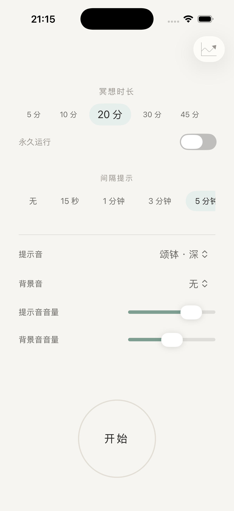

# 冥想闹钟 · MeditationAlarm

一款「设完就开始」的 iOS 冥想闹钟：选定时长与间隔提示后开始，**前台 / 后台 / 锁屏全场景可靠播放**提示音与结束音，计时期间屏幕常亮。视觉走宣纸 · 青瓷 · 水墨的清淡路线。



## 功能

- **全场景计时提醒** —— 自研调度链（GCD `DispatchSourceTimer`），锁屏不被系统节流；间隔提示音、自然结束三声渐强、手动结束单声，前后台锁屏表现一致
- **间隔提示** —— 无 / 15 秒 / 1 / 3 / 5 / 10 / 30 分钟，横滑胶囊选择
- **冥想时长** —— 5/10/20/30/45 分、1/2/5 小时、自定义；一行横滑胶囊，选中项放大 + 青瓷底
- **提示音 / 背景音** —— 8 种提示音 + 多种背景音，双音量独立调节，即选即试听
- **永久运行** —— 不限时长，一直响下去
- **屏幕常亮** —— 仅计时运行中阻止自动锁屏，暂停 / 结束 / 退后台自动恢复
- **灵动岛 / 锁屏** —— Live Activity 实时显示剩余时间
- **智能联动** —— 时长短于间隔时，开始自动扩展为间隔的 5 倍
- **冥想记录** —— 累计次数 / 时长 / 连续天数、日历热力图、按天历史列表、单条删除；实时活动上的「结束」先回 App 二次确认；不足 1 分钟的会话询问是否记录

## 运行

环境：Xcode 16+，iOS 17.0+，`xcodegen`。

```bash
xcodegen generate        # 工程由 project.yml 生成，拉下代码后必须跑一次
open MeditationAlarm.xcodeproj
```

模拟器或真机选择 `MeditationAlarm` scheme 直接运行。

## 项目结构

```
MeditationAlarmApp/          App 源码（入口 / 会话调度 / 音频引擎 / 设置页 / 根视图）
MeditationAlarmWidget/       灵动岛与锁屏 Live Activity
Packages/MeditationCore/     计时内核（App 与 Widget 共用，附单元测试）
Shared/                      两 target 共用的色板与排版
Resources/Audio/             提示音、背景音、静音守护素材
project.yml                  XcodeGen 工程配置
```

## 开发备注

- 内核单测：`cd Packages/MeditationCore && swift test`
- 调度链自测：Debug 构建带 `-selfTest` 启动参数（35 秒会话 + 12 秒间隔 + 雨声背景音），从日志验证 GCD 链触发
- 记录页自测：`-seedRecords` 造 9 条演示记录；`defaults write com.windlessd.MeditationAlarm debug.openRecords -bool true` 可直接进记录页
- 本地通知已按需求决策停用，提醒全部走音频通道；`ReminderScheduler` 保留未用

## 文档

- [`REQUIREMENTS.md`](REQUIREMENTS.md) —— 需求与全部决策记录（Q1–Q15）
- [`DESIGN.md`](DESIGN.md) —— 视觉设计规范
- [`STATUS.md`](STATUS.md) —— 第一阶段开发状态与真机验证清单
